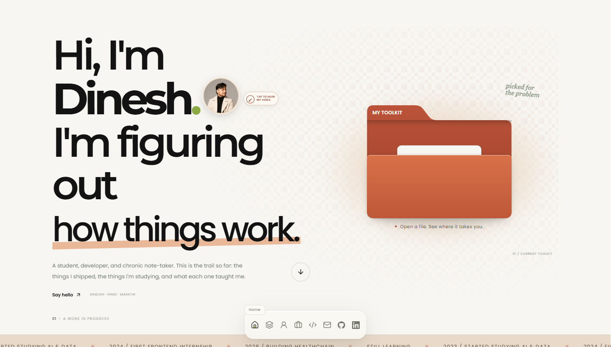

# Dinesh Jadhav — Portfolio

> **Builder & Note-Taker** · Mumbai, India  
> A minimal, editorial personal portfolio built with Next.js 16, React 19, Tailwind CSS, and GSAP.

---

### Preview

<div align="center">
  
</div>

---

### Highlights

- **Editorial Case Studies**: Deep architectural retrospectives with interactive live models.
- **Pixel Flow Field**: Viewport vector field canvas that automatically scatters as the user approaches.
- **Tactile Dock**: Floating navigation with kinetic magnification and subtle audio feedback.
- **Performance First**: Local-first state, Lenis smooth scrolling, and responsive layout across all screens.

---

### Tech Stack

- **Core**: Next.js 16 (App Router), React 19, TypeScript
- **Styles**: Tailwind CSS v4
- **Motion**: GSAP 3 (ScrollTrigger), Motion, Lenis

---

### Run Locally

```bash
git clone https://github.com/jadhavdineshdev/portfolio.git
cd portfolio/next-app
npm install
npm run dev
```

---

### Contact

- **Email**: [dineshjadhavdev@gmail.com](mailto:dineshjadhavdev@gmail.com)
- **LinkedIn**: [Dinesh Jadhav](https://www.linkedin.com/in/dinesh-jadhav-8a4273309/)
- **GitHub**: [@jadhavdineshdev](https://github.com/jadhavdineshdev)
